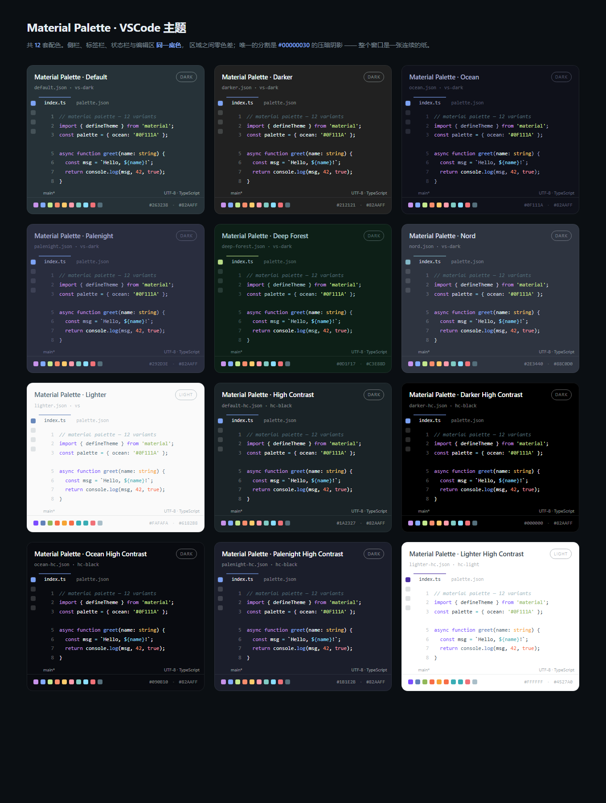

# Material Palette

Material 设计语言的 VSCode 配色合集，**12 套主题**，一个插件全部带走。

所有变体共享同一套语义调色板（关键字、字符串、函数、类型、常量……），只切换底色与对比度，所以换主题时代码的读法完全不用重新适应。

## 12 套配色

<p align="center">
  
</p>

注意每张卡片里活动栏、标签栏、状态栏和代码区是**同一个颜色**——没有一条分隔线。

| 主题名 | 底色 | UI Theme |
|--------|------|----------|
| Material Palette · Default | `#263238` 蓝灰 | vs-dark |
| Material Palette · Darker | `#212121` 纯深灰 | vs-dark |
| Material Palette · Ocean | `#0F111A` 海蓝黑 | vs-dark |
| Material Palette · Palenight | `#292D3E` 暗紫 | vs-dark |
| Material Palette · Deep Forest | `#0D1F17` 深林绿 | vs-dark |
| Material Palette · Nord | `#2E3440` 极夜蓝 | vs-dark |
| Material Palette · Lighter | `#FAFAFA` 浅色 | vs |
| Material Palette · High Contrast | `#1A2327` | hc-black |
| Material Palette · Darker High Contrast | `#000000` | hc-black |
| Material Palette · Ocean High Contrast | `#090B10` | hc-black |
| Material Palette · Palenight High Contrast | `#1B1E2B` | hc-black |
| Material Palette · Lighter High Contrast | `#FFFFFF` | hc-light |

## 设计取向：界面一体化

这个主题追求的不是强对比，而是**让整个窗口看起来是一张连续的纸**。

- **区域零色差**：侧栏、活动栏、标签栏、状态栏、终端面板全部与编辑区**同一个色值**，没有"深色侧栏 + 浅色编辑区"那种块状拼接。
- **区域边框不存在**：`sideBar.border` / `panel.border` / `statusBar.border` 用的是**底色本身**的半透明值（`#0F111A99`），叠加到底色上仍然是底色 —— 数学上就没有这条线。
- **真正的分隔是阴影，不是亮线**：编辑分组、peek 视图、diff 的边框统一用 `#00000030`（黑色 19%）**压暗**。深色底上更暗的线看起来是凹进去的缝，更亮的线则会发光刺眼 —— 这是两回事。
- **焦点环关闭**：`focusBorder` 置空，不额外描边。
- **缩进参考线 7%、空白字符 7%**，界面安静下来。

> 高对比变体是唯一例外：可访问性优先，保留实色边框 `contrastBorder`。

## 安装

**直接下载（推荐，无需等待市场审核）**

[`material-palette-1.3.1.vsix`](https://github.com/YONAN1269/material-palette/releases/latest/download/material-palette-1.3.1.vsix)

下载后在 VS Code 里按 `Ctrl+Shift+P` → **Extensions: Install from VSIX...** → 选刚下载的文件。
（Windows 用户的 `material-palette` 目录里也有一份，双击 `rebuild.bat` 会自动打包并安装。）

**命令行安装**

```bash
code --install-extension material-palette-1.3.1.vsix
```

装完必须**完全退出 VS Code 再重新启动**（详见下一节）。

## 装完发现"没变化"？

这是最常见的问题，几乎都是同一个原因：**VS Code 的扩展清单在启动时扫描一次就缓存在内存里**，`Developer: Reload Window` 不会重新扫描。所以安装动作如果发生在 VS Code 已经运行之后，你看到的仍然是旧版本。

跑一下体检脚本，它会直接告诉你答案：

```bash
python scripts/diagnose.py
```

```
── 4. 为什么「装了没变化」
  VS Code 主进程启动 : 2026-10-20 15:18:56
  扩展最新写入      : 2026-10-20 15:19:54

  ❌ 结论：VS Code 是在扩展被写入**之前**启动的。
     必须完全退出并重新启动。
```

正确做法：关掉所有 VS Code 窗口 → 任务管理器确认没有 `Code.exe` 残留 → 重新打开。只看扩展详情页标题和主题选择器里的名字就能确认版本。

## 启用

`Ctrl+K Ctrl+T` 打开主题选择器，输入 `Material Palette`，12 套里挑一套。想用 `settings.json` 固定：

```json
{
  "workbench.colorTheme": "Material Palette · Ocean"
}
```

## 支持作者

这个插件免费、无广告、无功能限制。如果它让你每天看代码舒服一点，欢迎请我喝杯咖啡 —— 完全是自愿的，不影响任何功能。

<p align="center">
  
  <br>
  <sub>微信扫码 · 金额随意</sub>
</p>

也欢迎提 issue 反馈配色问题 —— 特别是你在某个语言里遇到"这个 token 颜色不对"的情况，附上截图我就能修。

## 自定义

主题装好后可以用 `settings.json` 局部覆盖，不影响其他变体：

```json
{
  "workbench.colorCustomizations": {
    "[Material Palette · Ocean]": {
      "editor.background": "#0D1017",
      "editorGroup.border": "#00000000"
    }
  },
  "editor.tokenColorCustomizations": {
    "[Material Palette · Ocean]": {
      "comments": "#5C6B7A"
    }
  }
}
```

## 修改配色

### 想调界面有多「平」：改 `tune.ini`（不用碰代码）

项目根目录有个 `tune.ini`：

```
material-palette\tune.ini
```

用记事本打开，里面只有三个数字：

```ini
SEAM = 0.0          # 侧栏/状态栏比编辑区暗多少。0 = 完全同色
DIVIDER = 0.19      # 分隔线（黑色阴影）的浓度。0 = 一点线都没有
ACCENT_LINE = 0.6   # 当前标签顶部那条亮线的透明度。0 = 全去掉
```

改完保存 → 双击 `rebuild.bat` → **完全退出 VS Code 再打开**（关掉所有窗口，任务管理器里不能有 `Code.exe`；只按「重载窗口」是不够的）。不想手动找进程，就直接双击 `restart-code.bat`，它会帮你关干净再启动。

三个值都是 0~1 的小数，改大改小立刻能看出差别：

| 想要的效果 | 怎么改 |
|---|---|
| 最平，一条线都不要 | `DIVIDER = 0`、`ACCENT_LINE = 0` |
| 侧栏和编辑区严格同色 | `SEAM = 0`（默认） |
| 能看出侧栏在哪，但不像块状拼接 | `SEAM = 0.03` |
| 终端面板上面那条线太刺眼 | `ACCENT_LINE = 0.2` 或 `0` |

### 改代码（进阶）

`tune.ini` 里的值会覆盖 `scripts/generate_themes.py` 第 59 / 67 / 74 行的默认值 `SEAM` / `DIVIDER` / `ACCENT_LINE`。直接在代码里改也一样，只是下次 `tune.ini` 又会被读进来。

> `DIVIDER` 是**黑色**的透明度，不是前景色。用前景色（浅色）做线会让线发光，深色底上永远显眼 —— 这是最容易搞反的地方。

### 其他

- 新增一套配色：往 `VARIANTS` 加 `dict(id=..., label=..., ui=..., bg=..., fg=..., pal=DARK)`，`package.json` 会自动同步，不用手改清单。
- 调整语义色：改 `DARK` / `LIGHT` 字典。
- 重新生成并打包：

```bash
rebuild.bat          # Windows：生成 → 校验 → 打包 → 安装
```

或手动：

```bash
python scripts/generate_themes.py
python scripts/validate.py
npx @vscode/vsce package --no-dependencies
```

## 目录结构

```
material-palette/
├── publish.ini               # ★ 发布配置：图片地址 / 仓库地址 / 发布者 ID
├── tune.ini                  # ★ 调参就改这个（记事本打开，三个数字）
├── rebuild.bat               # ★ 双击它：生成 → 校验 → 打包 → 安装
├── restart-code.bat          # ★ 双击它：彻底关掉 VS Code 再启动（装完必须做）
├── publish.bat               # ★ 双击它：体检 → 打包 → 发布到扩展市场
├── package.json              # 插件清单（themes 数组由生成器回写）
├── icon.png                  # 插件图标
├── preview.html              # 12 套配色总览
├── assets/wechat-pay.jpg     # 赞赏码
├── themes/                   # 12 个主题 JSON，每套 350+ 色槽
└── scripts/
    ├── generate_themes.py    # 唯一数据源
    ├── validate.py           # 对比度 / 格式自检
    ├── diagnose.py           # 体检：装的是哪个版本、为什么没生效
    ├── preflight.py          # 发布前体检
    ├── apply_publish_config.py   # 把 publish.ini 写进 package.json
    ├── inject_readme_images.py   # 把 README 图片换成绝对 https 地址
    └── install_local.py      # 解包安装（绕过需要提权的 code CLI）
```

## 致谢

配色体系受 [Material Theme](https://marketplace.visualstudio.com/items?itemName=Equinusocio.vsc-material-theme)（Equinusocio）与 Google Material Design 色板启发。本项目独立实现，不与上游共享代码。

## License

MIT
